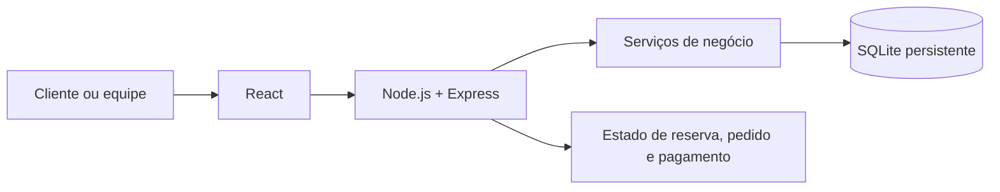

# Arquitetura

> API Express, SQLite, autenticação e sincronização implementados. Estado e trabalho restante: [pendências atuais](pendencias-atuais.md). Registros de sessões anteriores abaixo são históricos.

Este documento descreve a arquitetura implementada. [Voltar ao README](../README.md) · [Pendências atuais](pendencias-atuais.md).

## Visão

React/JavaScript compõe a interface; Node.js/Express fornece a API HTTP; SQLite persiste dados no servidor. DB Browser é uma ferramenta opcional de inspeção local.

## Limites dos módulos

Interface exibe dados e coleta ações; rotas validam entrada e autorização; serviços aplicam regras e transações; persistência acessa SQLite; integração de pagamento é simulada. Por responsabilidade única, o serviço de reserva decide disponibilidade e confirmação, enquanto a rota apenas traduz HTTP e chama esse serviço.

## Fluxo de dados

Uma ação da interface chega à API, é autorizada, validada e processada em transação. A resposta atualiza a tela. Estados são consultados a cada dois segundos e ao recuperar o foco. Snapshot JSON e projeções relacionais são persistidos na mesma transação.
