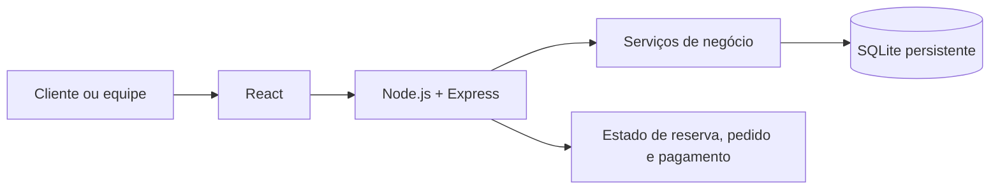

# Arquitetura

Este documento descreve a arquitetura proposta, não uma implementação existente. [Voltar ao README](../README.md).

## Visão

React/JavaScript seria a interface; Node.js/Express, a API HTTP; SQLite persistiria dados no servidor. DB Browser seria apenas ferramenta de inspeção local. A hospedagem permanece pendente até comprovar armazenamento persistente.

## Limites dos módulos

Interface exibe dados e coleta ações; rotas validam entrada e autorização; serviços aplicam regras e transações; persistência acessa SQLite; integração de pagamento é simulada. Por responsabilidade única, o serviço de reserva decide disponibilidade e confirmação, enquanto a rota apenas traduz HTTP e chama esse serviço.

## Fluxo de dados

Uma ação da interface chega à API, é autorizada, validada e processada em transação quando altera disponibilidade, comanda, crédito ou pagamento. A resposta atualiza a tela. Atualização periódica da API é uma proposta para estados de espera e rodadas.
