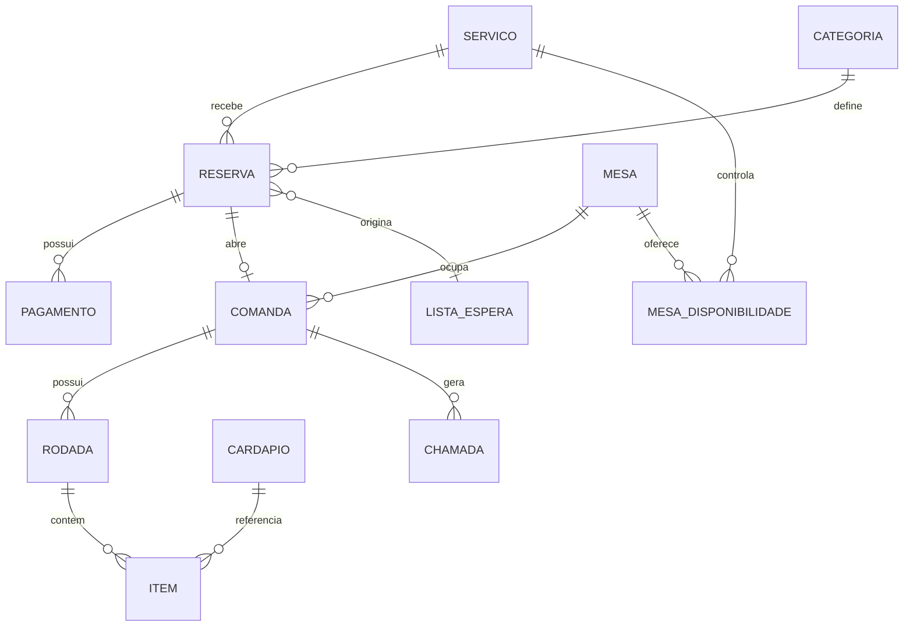

# Banco de dados

Este documento propõe o modelo persistente e suas restrições. [Voltar ao README](../README.md).

## Entidades

Entidades propostas: `servico(id,data,horario,status)`, `mesa(id,capacidade,status)`, `categoria(id,nome,preco_reserva_centavos)`, `mesa_disponibilidade(servico_id,mesa_id,status)`, `reserva(id,servico_id,categoria_id,contato,status,credito_centavos)`, `lista_espera(id,servico_id,nome,categoria,whatsapp,email,status)`, `cardapio(id,categoria,nome,preco_centavos,ativo)`, `comanda(id,reserva_id,mesa_id,status)`, `rodada(id,comanda_id,status)`, `item(id,rodada_id,cardapio_id,nome_registrado,preco_centavos,quantidade,status)`, `pagamento(id,reserva_id,comanda_id,valor_centavos,tipo,status,referencia)`, `chamada(id,comanda_id,tipo,status)`.

Preços são inteiros em centavos e o item preserva nome e preço no momento do pedido. Disponibilidade por serviço não é a ocupação física: a primeira responde se uma reserva pode ser feita; a segunda informa se a mesa está pronta, ocupada, aguardando limpeza ou livre.

## Restrições críticas

Unicidade deve impedir duas reservas confirmadas para a mesma mesa/serviço, duas comandas ativas para a reserva, aplicação dupla do crédito e liquidações concorrentes. Check-in e acomodação devem ser idempotentes. Mudanças de disponibilidade, crédito e pagamento devem ocorrer em transação atômica; a equipe verifica com testes concorrentes e consulta dos registros após reinício.
